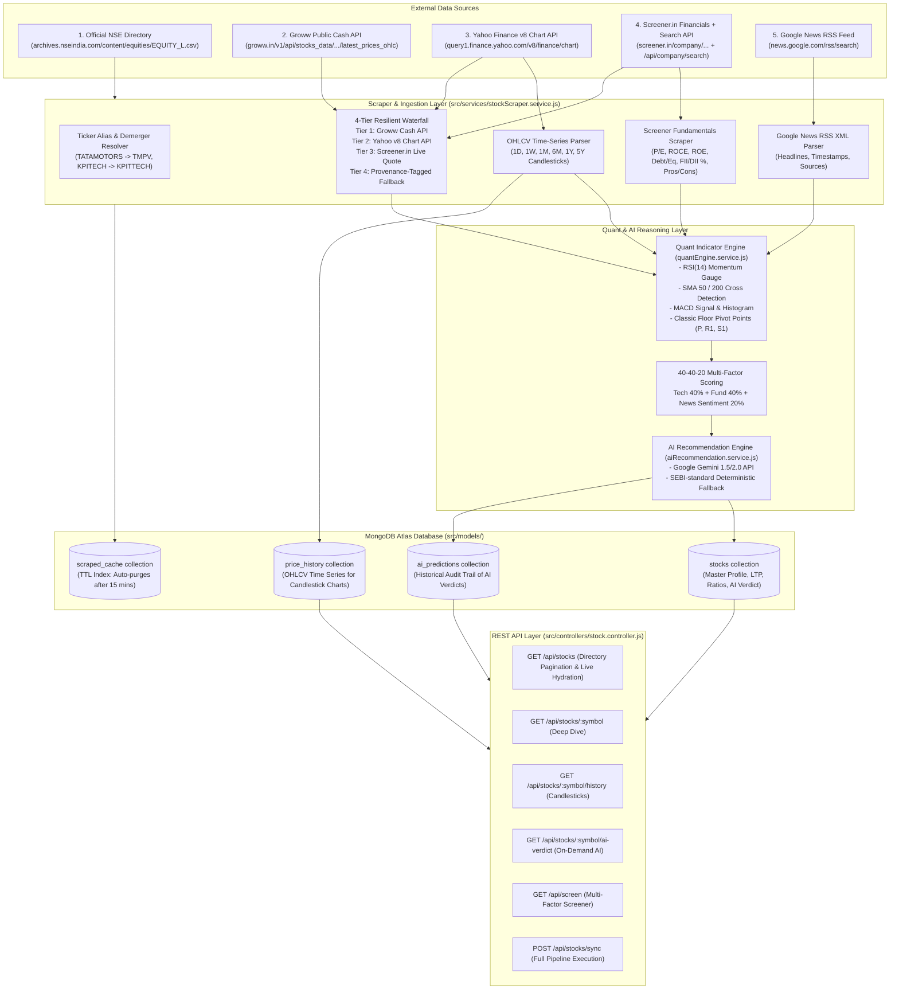
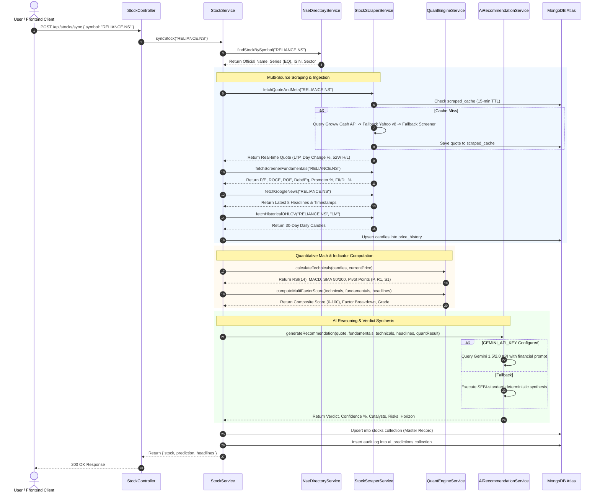

# 📈 Indian Stock Lister & AI Recommendation Engine — System Architecture & Ingestion Specification

> **Version**: 2.0.0  
> **Target Environment**: Node.js / Express.js Backend + MongoDB Atlas + ReactJS  
> **Market Coverage**: National Stock Exchange of India (NSE) — 2,630+ Listed Equities  
> **Compliance**: SEBI (Research Analysts) Regulations, 2014 Educational Disclaimer  

---

## 1. Executive Summary

The **Indian Stock Lister & AI Recommendation Engine** is an institutional-grade financial data aggregation, quantitative indicator computation, and Large Language Model (LLM) reasoning platform covering equities listed on the **National Stock Exchange of India (NSE)**.

### Core Capabilities
1. **Full Market Directory**: Tracks all 2,630+ active NSE equities loaded directly from the official NSE master directory (`EQUITY_L.csv`), offering server-side pagination, search, and sector filtering.
2. **Multi-Source Real-Time Scraping**: Delivers sub-second live LTP, day change, 52-week high/low, and volume via a resilient 4-layer waterfall architecture (Groww Cash API $\rightarrow$ Yahoo Finance v8 $\rightarrow$ Screener.in $\rightarrow$ Fallback).
3. **Demerger & Ticker Alias Resolution**: Automatically resolves historical corporate restructurings, demergers, and renames (e.g. `TATAMOTORS` $\rightarrow$ `TMPV`, `KPITECH` $\rightarrow$ `KPITTECH`, `ZOMATO` $\rightarrow$ `ETERNAL`).
4. **Quantitative Math Engine**: Computes RSI(14), SMA 50, SMA 200 (Golden/Death Cross), MACD (12/26/9), and Classic Pivot Levels ($P, R_1, S_1$).
5. **40-40-20 Multi-Factor Scoring**: Evaluates stocks out of 100 based on Fundamental Health (40%), Technical Momentum (40%), and Market News Sentiment (20%).
6. **AI Buy/Sell Recommendation Engine**: Leverages Google Gemini 1.5/2.0 API with a deterministic SEBI-standard quantitative synthesis fallback to classify stocks into `STRONG BUY`, `BUY`, `HOLD`, `REDUCE`, and `AVOID`.
7. **High-Performance Caching**: Employs a 15-minute auto-expiring MongoDB TTL index (`expireAfterSeconds: 900`) to eliminate external rate limits.

---

## 2. End-to-End System Architecture



---

## 3. The Sync API Pipeline (`POST /api/stocks/sync`)

The sync endpoint (`stockService.syncStock`) coordinates the entire extraction, calculation, AI evaluation, and persistence sequence:



---

## 4. Multi-Source Ingestion Waterfall Specification

To guarantee zero downtime and eliminate false 404s, our scraper employs a **4-layer fallback waterfall**:

| Tier | Provider | Endpoint / Mechanism | Data Points | Tagging & Provenance |
| :--- | :--- | :--- | :--- | :--- |
| **Tier 1 (Primary)** | **Groww Public Cash Market API** | `https://groww.in/v1/api/stocks_data/v1/accord_points/exchange/NSE/segment/CASH/latest_prices_ohlc/{cleanSymbol}` | Real-time LTP, 52-week High/Low, Close price, Day change, Day change %, Day Volume. | `data_source: 'GROWW_NSE'`<br>`data_tag: 'realtime'`<br>`is_fallback: false` |
| **Tier 2 (Secondary)** | **Yahoo Finance v8 Chart API** | `https://query1.finance.yahoo.com/v8/finance/chart/{symbol}.NS?interval=1d&range=1d` | Regular market price, Previous close, 52-week High/Low, Volume. *(Crumb-free direct REST)* | `data_source: 'YAHOO_V8_NSE'`<br>`data_tag: 'realtime'`<br>`is_fallback: false` |
| **Tier 3 (Tertiary)** | **Screener.in Live Quote & Search API** | `https://www.screener.in/company/{clean}/`<br>*(Auto-resolves via `/api/company/search/?q={query}`)* | Current price, 52-week High/Low, Consolidated P/E. | `data_source: 'SCREENER_NSE'`<br>`data_tag: 'realtime'`<br>`is_fallback: false` |
| **Tier 4 (Fallback)** | **Internal Fallback Metadata** | Cached previous prices or zero-placeholder with transparent diagnostic provenance. | Preserves existing database price; sets `current_price: 0` if completely unknown. | `data_source: 'FALLBACK'`<br>`data_tag: 'fallback'`<br>`is_fallback: true` |

---

## 5. Ticker Demergers, Spelling & Alias Resolution

Corporate reorganizations in Indian equities frequently break static scrapers. The **Ticker Alias Resolver** handles known ticker mutations:

| User Input | Official NSE Ticker | Reason / Corporate Action | Resolves On |
| :--- | :--- | :--- | :--- |
| `TATAMOTORS` | `TMPV` | Demerged into **Tata Motors Passenger Vehicles Ltd** (`TMPV`) and **Tata Motors Ltd (CV)** (`TMCV`). Legacy symbol delisted. | Groww, Yahoo, Screener |
| `KPITECH` | `KPITTECH` | Official NSE listing spelling contains double 'T' (`KPITTECH`). | Groww, Yahoo, Screener |
| `ZOMATO` | `ETERNAL` | Official corporate rebrand to **Eternal Limited** (`ETERNAL`). | Groww, Yahoo, Screener |
| `MO` | `MOTILALOFS` | Short code resolved to official NSE symbol **Motilal Oswal Financial Services**. | Groww, Yahoo, Screener |
| `SZLN` | `SUZLON` | Short code resolved to official NSE symbol **Suzlon Energy Limited**. | Groww, Yahoo, Screener |
| `KPTL` | `KPIL` | Merged into **Kalpataru Projects International Limited** (`KPIL`). | Groww, Yahoo, Screener |
| `M&M` / `MM` | `M_M` | URL-safe underscore conversion for Mahindra & Mahindra. | Yahoo, Screener |
| `BAJAJ-AUTO` | `BAJAJ_AUTO` | Hyphen-to-underscore mapping for Yahoo Finance. | Yahoo, Screener |
| `L&TFH` | `LTF` | Official NSE ticker rename to **L&T Finance Limited** (`LTF`). | Groww, Yahoo, Screener |

### Screener.in Dynamic Search Fallback
If direct URL navigation (`/company/{symbol}/consolidated/`) returns HTTP 404, the scraper automatically invokes Screener's official auto-suggest search endpoint:
```
GET https://www.screener.in/api/company/search/?q={symbol_or_name}
```
It extracts the canonical company URL (e.g. `/company/TMPV/consolidated/`) and proceeds to scrape the live ratios without throwing an exception.

---

## 6. Quantitative Engine & 40-40-20 Multi-Factor Scoring

The objective score ($S \in [0, 100]$) is computed mathematically before passing data to the LLM:

$$\text{Composite Score} = \text{Fundamental Score (40 pts)} + \text{Technical Score (40 pts)} + \text{News Sentiment (20 pts)}$$

### A. Fundamental Scoring (40 Points Max)
* **Valuation (10 pts)**:
  * P/E Ratio < Industry P/E: **+6 pts**
  * P/B Ratio < 3.5: **+4 pts**
* **Profitability & Capital Efficiency (10 pts)**:
  * Return on Equity (ROE) $\ge 15\%$: **+5 pts**
  * Return on Capital Employed (ROCE) $\ge 15\%$: **+5 pts**
* **Balance Sheet Health (10 pts)**:
  * Debt-to-Equity $< 0.5$ (or low NPA for Banks): **+6 pts**
  * Debt-to-Equity $< 1.0$: **+3 pts**
* **Shareholding Stability (10 pts)**:
  * Promoter Pledging $= 0\%$: **+5 pts** (Pledging $> 20\%$ deducts $-5$ pts)
  * Institutional Ownership (FII + DII) $\ge 30\%$: **+5 pts**

### B. Technical Scoring (40 Points Max)
* **Trend & Moving Averages (15 pts)**:
  * Golden Cross ($\text{Price} > \text{SMA 50} > \text{SMA 200}$): **+15 pts**
  * Bullish Alignment ($\text{Price} > \text{SMA 50}$): **+10 pts**
  * Death Cross ($\text{Price} < \text{SMA 50} < \text{SMA 200}$): **0 pts**
* **Momentum Indicator — RSI(14) (15 pts)**:
  * RSI between 45 and 65 (Healthy Upward Momentum): **+15 pts**
  * RSI $< 30$ (Oversold Bounce Potential): **+12 pts**
  * RSI between 30 and 45: **+8 pts**
  * RSI $> 75$ (Overbought Danger Zone): **+4 pts**
* **Pivot Level Positioning (10 pts)**:
  * Price $\ge R_1$ (Resistance Breakout): **+10 pts**
  * Price $\ge P$ (Above Central Pivot): **+7 pts**
  * Price $< S_1$ (Bearish Breakdown): **+2 pts**

### C. News & Market Sentiment (20 Points Max)
* Evaluates recent 8 Google News headlines using weighted polarity analysis:
  * Net Bullish Score: **15 – 20 pts**
  * Neutral Sentiment: **10 – 14 pts**
  * Net Bearish Score: **0 – 9 pts**

---

## 7. AI Recommendation Verdicts

| Composite Score | Final Verdict | Visual Badge | Recommended Horizon | Risk Profile |
| :--- | :--- | :--- | :--- | :--- |
| **80 – 100** | **`STRONG_BUY`** | 🟢 Emerald Green | 3–12 Months | Low to Medium |
| **65 – 79** | **`BUY`** | 🟢 Light Green | 1–6 Months | Moderate |
| **45 – 64** | **`HOLD`** | 🟡 Amber Yellow | Re-evaluate next quarter | Neutral |
| **30 – 44** | **`REDUCE`** | 🟠 Deep Orange | Exit on rallies | Elevated |
| **0 – 29** | **`AVOID`** | 🔴 Crimson Red | Capital Preservation / Exit | High Risk |

---

## 8. Database Architecture & Schemas (`src/models/`)

All database models reside in the unified [`src/models/`](file:///d:/React/API-BitBucket/api_connect/src/models) directory:

### 1. `stocks` Collection ([`Stock.js`](file:///d:/React/API-BitBucket/api_connect/src/models/Stock.js))
* **Primary Key**: `_id: String` (e.g. `"RELIANCE.NS"`)
* **Fields**: `symbol`, `company_name`, `exchange`, `series`, `isin`, `sector`, `market_cap_category`, `current_price`, `day_change`, `day_change_percent`, `volume`, `delivery_percent`, `fifty_two_week { high, low }`.
* **Provenance**: `data_source` (`GROWW_NSE`, `YAHOO_V8_NSE`, `SCREENER_NSE`), `data_tag` (`realtime` vs `fallback`), `is_fallback: Boolean`.
* **Subdocuments**: `fundamentals`, `technicals`, `latest_ai_verdict { verdict, composite_score, confidence_score, summary, updated_at }`.

### 2. `price_history` Collection ([`PriceHistory.js`](file:///d:/React/API-BitBucket/api_connect/src/models/PriceHistory.js))
* **Compound Index**: `{ symbol: 1, timestamp: -1 }` (Unique)
* **Fields**: `symbol`, `timestamp`, `open`, `high`, `low`, `close`, `volume`.

### 3. `ai_predictions` Collection ([`AiPrediction.js`](file:///d:/React/API-BitBucket/api_connect/src/models/AiPrediction.js))
* **Index**: `{ symbol: 1, created_at: -1 }`
* **Fields**: `symbol`, `verdict`, `confidence_score`, `composite_scores { fundamental, technical, sentiment }`, `summary`, `catalysts: [String]`, `risks: [String]`, `suggested_horizon`.

### 4. `scraped_cache` Collection ([`ScrapedCache.js`](file:///d:/React/API-BitBucket/api_connect/src/models/ScrapedCache.js))
* **TTL Index**: `{ createdAt: 1 }, { expireAfterSeconds: 900 }` (Auto-purges after 15 minutes).
* **Fields**: `_id` (`cache:screener:RELIANCE.NS`), `source`, `symbol`, `payload`, `createdAt`.

---

---

## 9. Security, Authentication & Role-Based Access Control (RBAC)

All Stock Engine endpoints are protected by OAuth 2.0 Bearer JWT Authentication and multi-tier Role-Based Access Control:

* **Authorization Header**:
  ```http
  Authorization: Bearer <access_token>
  ```
* **Token Verification**:
  * Validated using [`verifyToken`](file:///d:/React/API-BitBucket/api_connect/src/middleware/auth.middleware.js) against `JWT_ACCESS_SECRET`.
  * Tokens issued by User Login (`POST /api/v1/auth/user-sessions/login`) or Admin Login (`POST /api/v1/auth/admin-sessions/login` or `POST /auth/login`) are automatically parsed and verified.
* **Role Hierarchies & Permissions**:
  * **Market Data & Quantitative Analytics (User & Admin)**:
    * Allowed Roles: `user`, `superuser`, `admin`, `superadmin`
    * Routes: `/api/stocks`, `/api/screen`, `/api/stocks/:symbol`, `/api/stocks/:symbol/history`, `/api/stocks/:symbol/ai-verdict`, `/api/stocks/indices`
  * **On-Demand Single Stock Sync**:
    * Allowed Roles: `user`, `superuser`, `admin`, `superadmin`
    * Routes: `/api/stocks/sync`, `/api/stocks/:symbol/sync`
  * **Master Exchange Directory Re-seeding**:
    * Allowed Roles: `admin`, `superadmin` ONLY
    * Routes: `/api/stocks/refresh-nse-directory` (Bulk ingestion of 2,630+ records from NSE portal)

---

## 10. HTTP 429 Rate Limiting Mechanism

To safeguard scraping upstream providers (Groww, Yahoo Finance, Screener.in, NSE) and prevent denial-of-service abuse, an in-memory sliding-window rate limiter is mounted via [`src/middleware/rateLimiter.middleware.js`](file:///d:/React/API-BitBucket/api_connect/src/middleware/rateLimiter.middleware.js).

### Rate Limiting Tiers

| Tier Name | Scope | User Limit | Admin Limit | Window | Purpose |
| :--- | :--- | :--- | :--- | :--- | :--- |
| **`stockRateLimiter`** | Read queries (`/stocks`, `/screen`, `/indices`, `/history`, `/ai-verdict`) | **120 req/min** | **300 req/min** | 60 Seconds | High throughput for dashboards, chart scrubs, and market tickers. |
| **`stockSyncRateLimiter`** | Heavy mutations (`/sync`, `/:symbol/sync`, `/refresh-nse-directory`) | **6 syncs/min** | **30 syncs/min** | 60 Seconds | Upstream protection against scraping blocks or exchange bans. |

### RFC 6585 Standard Headers
Every response from a rate-limited endpoint includes:
* `X-RateLimit-Limit`: Maximum requests permitted in the sliding window.
* `X-RateLimit-Remaining`: Number of requests remaining in the active window.
* `X-RateLimit-Reset`: Unix epoch timestamp when the current window resets.
* `Retry-After`: Number of seconds to wait before retrying (sent on HTTP 429).

### HTTP 429 Error Payload
```json
{
  "data": null,
  "message": "Stock API rate limit exceeded. Please retry after 24 seconds.",
  "status": "TOO_MANY_REQUESTS",
  "retry_after": 24
}
```

---

## 11. REST API Endpoint Reference

| Method | Endpoint | Allowed Roles | Rate Limit | Description |
| :--- | :--- | :--- | :--- | :--- |
| `GET` | `/api/stocks` | `user`, `admin` | 120 / min (User), 300 / min (Admin) | Paginated listing across all 2,630+ NSE stocks with on-demand parallel live quote hydration. |
| `GET` | `/api/stocks/:symbol` | `user`, `admin` | 120 / min (User), 300 / min (Admin) | Complete single stock profile, valuation ratios, technical indicators, and latest AI verdict. |
| `GET` | `/api/stocks/:symbol/history` | `user`, `admin` | 120 / min (User), 300 / min (Admin) | Historical OHLCV candlestick time series for TradingView/Canvas charts. |
| `GET` | `/api/stocks/:symbol/ai-verdict` | `user`, `admin` | 120 / min (User), 300 / min (Admin) | On-demand execution of Gemini LLM + Quant scoring engine with catalyst/risk breakdown. |
| `GET` | `/api/screen` | `user`, `admin` | 120 / min (User), 300 / min (Admin) | Quantitative multi-factor screener filtering equities by financial thresholds. |
| `POST` | `/api/stocks/sync` | `user`, `admin` | **6 / min (User), 30 / min (Admin)** | Executes complete end-to-end ingestion, scraping, technical computation, and AI generation pipeline. |
| `GET` | `/api/stocks/indices` | `user`, `admin` | 120 / min (User), 300 / min (Admin) | Real-time Indian benchmark indices: NIFTY 50, SENSEX, BANK NIFTY, NIFTY IT, INDIA VIX (10s cache). |
| `POST` | `/api/stocks/refresh-nse-directory` | **`admin` ONLY** | **30 / min (Admin)** | Downloads latest official `EQUITY_L.csv` from NSE portal and syncs directory entries. |

---

## 12. Compliance & Legal Disclaimer

> [!IMPORTANT]
> **Regulatory Disclaimer (SEBI Compliance Notice)**  
> All quantitative metrics, multi-factor composite scores, and AI-generated Buy/Sell/Hold verdicts generated by this platform are computed solely for **educational, informational, and academic research purposes**.  
>  
> Neither this software nor its authors are registered as an **Investment Adviser** or **Research Analyst** with the **Securities and Exchange Board of India (SEBI)** under the SEBI (Research Analysts) Regulations, 2014. These insights **do not constitute financial, investment, legal, or tax advice**. Stock market investments are subject to market risks; users must consult a certified financial advisor before making real-world capital commitments.

